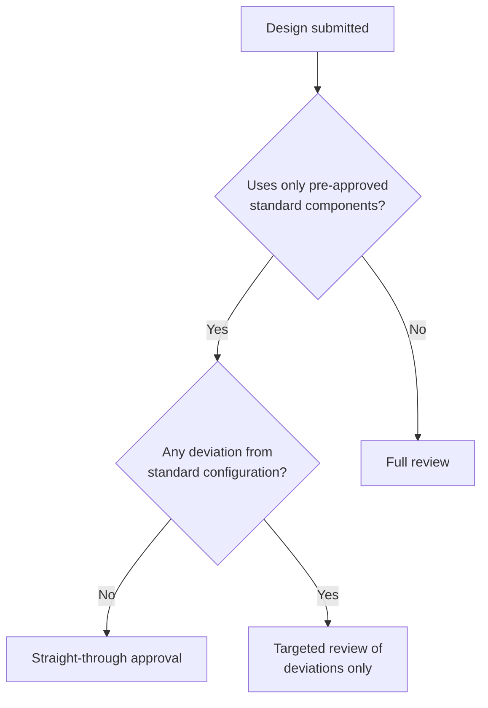

# Straight-through approval

If a design is built entirely on **pre-approved standard components**, most of
the review has already been done. Give it a fast path.

## Decision guide

## Criteria for straight-through

All three must be true:

1. Every component appears on the approved standards list.
2. Each component uses its standard configuration with no overrides.
3. The design owner has completed the self-service checklist.

## Why it matters

Review teams that start every request from scratch stay permanently reactive.
Encoding the standard into a fast path frees experts for the reviews that
actually need judgment.

## Related

- [Observe first](../getting-started/observe-first.md) describes how this pattern was found.
